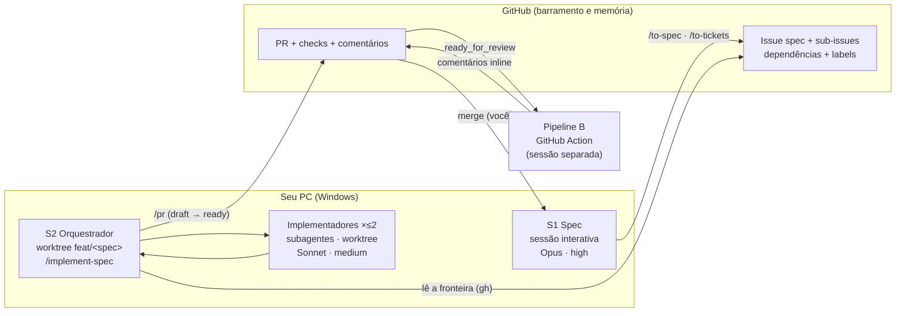

# Workflow Agêntico Spec-Driven com Claude Code: especificação v2 (plano Pro, projetos pessoais)

> **Data:** 2026-11-13 · **Plano:** Claude Pro (individual) · **Stack:** JavaScript/Node, React, Next.js
> **Ambiente:** Windows 11; Claude Code 2.1.292 no CLI do PATH e 2.1.323 na extensão do VS Code
> **Prioridade:** skills do Matt Pocock como espinha dorsal, sem contrariar os princípios do Superpowers.
> **Status:** especificação. O harness ainda não foi construído. A v1 (geral, com recursos de Team/Enterprise) foi substituída por esta.

---

## Sumário

0. [O que mudou da v1 para a v2](#0-o-que-mudou-da-v1-para-a-v2)
1. [Resumo executivo](#1-resumo-executivo)
2. [O que o plano Pro permite (e o que fica de fora)](#2-o-que-o-plano-pro-permite)
3. [Convivência: Matt Pocock × Superpowers × outros plugins](#3-convivência-matt-pocock--superpowers--outros-plugins)
4. [Princípios que guiam o harness](#4-princípios-que-guiam-o-harness)
5. [Arquitetura para um dev solo](#5-arquitetura-para-um-dev-solo)
6. [Pipeline A: Desenvolvimento (SDD + TDD)](#6-pipeline-a-desenvolvimento-sdd--tdd)
7. [Pipeline B: Review de PR no GitHub](#7-pipeline-b-review-de-pr-no-github)
8. [Paralelismo com worktrees (com moderação)](#8-paralelismo-com-worktrees)
9. [Stack JS/Node/Next: impacto no harness](#9-stack-jsnodenext-impacto-no-harness)
10. [Mods: o que instalar agora](#10-mods-o-que-instalar-agora)
11. [Inventário mínimo do harness](#11-inventário-mínimo-do-harness)
12. [Roadmap](#12-roadmap)
13. [Decisões em aberto](#13-decisões-em-aberto)
14. [Fontes](#14-fontes)

---

## 0. O que mudou da v1 para a v2

| Tema | v1 | v2 |
|---|---|---|
| Recursos remotos | Todos os planos | **Só o que o Pro permite**. Saíram Code Review gerenciado (Team/Enterprise) e managed settings. Projects, channels e agent teams ficam de fora por custo e complexidade. |
| Paralelismo | 2 a 5 implementadores | **No máximo 2.** Subagentes consomem a mesma cota do Pro. |
| Orquestração | Skill e depois Dynamic Workflow | **Skill do Matt** (`/implement-spec`). Workflows são opcionais: vêm desligados no Pro. |
| Superpowers | Uso seletivo via `skillOverrides` | **Correção:** `skillOverrides` **não se aplica a skills de plugin**. A política nova está na seção 3. |
| Plugins já instalados | Não analisados | Diagnóstico de 5 plugins sincronizados da sua conta claude.ai (seção 3) |
| Stack | Indefinida | JS/Node/React/Next. Impactos na seção 9. |
| Mods | Ideia de "cockpit" futuro | **4 mods revisados e prontos para instalar** (seção 10) |

---

## 1. Resumo executivo

1. **Dois pipelines e um barramento.** O Pipeline A (spec → tickets → TDD) roda localmente. O Pipeline B (review de PR) roda no GitHub Actions, numa sessão separada que não vê o raciocínio de quem escreveu o código. Os dois só conversam pelo GitHub: issues, sub-issues com dependências, labels, PRs e comentários.
2. **Matt Pocock na espinha dorsal:**
   - `/grill-with-docs` para alinhar e registrar glossário e ADRs;
   - `/to-spec` para publicar a spec como issue;
   - `/to-tickets` para criar sub-issues com dependências;
   - `/implement` ou `/implement-spec` para implementar com TDD;
   - `/mattpocock-skills:code-review` para o review;
   - `/pr` para o corpo do PR e `/retro` para melhorar o ambiente.
3. **O Superpowers fica desligado nos projetos do harness, mas os princípios dele ficam.** O hook dele força "brainstorming antes de tudo" e disputa o fluxo do Matt. Os princípios (TDD sempre, debugging sistemático, evidência antes de declarar pronto, simplicidade) viram regras do harness: skills do Matt, hooks e Definition of Done.
4. **O que nunca pode falhar vai para a camada determinística** (hooks, regras `deny`, CI). `CLAUDE.md` e skills só orientam.
5. **Quem faz não julga.** A crítica da spec e o review rodam em subagentes com contexto novo, somente leitura, ou no CI.
6. **Cota do Pro é um recurso escasso.** Opus 5.5 fica no planejamento e no review; Sonnet 5.5 implementa; Haiku 5.5 explora. No máximo 2 implementadores em paralelo, e review remoto só quando o PR fica *ready for review*.
7. **Mods para enxergar o fluxo:**
   - `agent-flow`: árvore de subagentes;
   - `pull-request-pane`: PRs, issues, CI e review;
   - `quota-meter`: limites de 5 horas e de 7 dias do Pro;
   - `context-lens`: uso de contexto.
   Todos com o código revisado (seção 10).
8. **Comece sequencial.** O paralelismo entra só depois que um projeto piloto rodar ponta a ponta sem surpresas.

---

## 2. O que o plano Pro permite

| Recurso | No Pro? | Como usar aqui |
|---|---|---|
| Claude Code (CLI e VS Code), skills, subagentes, hooks, plugins, **mods** | ✅ | Base de tudo |
| Modelo padrão | Opus 5.5 | Opus para spec, arquitetura e review; Sonnet e Haiku nos subagentes |
| Git worktrees (`claude -w`, `isolation: worktree`) | ✅ | Implementadores isolados |
| Cross-session messaging (sessões locais) | ✅ | Opcional, entre a sessão de spec e o orquestrador |
| Dynamic workflows | ⚠️ **Desligado por padrão** no Pro (`enableWorkflows`), com tamanho "small" (menos de 5 agentes) | Opcional na etapa 4 |
| GitHub Action `claude-code-action` com `CLAUDE_CODE_OAUTH_TOKEN` | ✅ Consome a **mesma cota** do Pro | Pipeline B |
| Cloud sessions, auto-fix de PR (`/autofix-pr`) | ✅ Consomem a mesma cota | Opcional na etapa 4 |
| Scheduled tasks com gatilho do GitHub | ✅ Rodam com a sua identidade e têm limite por hora | Não usar no início |
| Ultrareview (`/code-review ultra`) | ⚠️ **3 execuções grátis, uma única vez**; depois, US$ 5 a 25 cada em créditos | Reservar para um PR grande e crítico |
| Projects (orquestrador na nuvem) | ✅ Beta | **Fora.** As threads não carregam as skills do repo, e para um dev solo isso é exagero. |
| Agent teams | Experimental | **Fora.** Custo alto de tokens e não isolam arquivos. |
| Channels | ✅, exige Bun | **Fora.** Desnecessário. |
| Code Review gerenciado (`REVIEW.md`) | ❌ Só Team e Enterprise | Substituído pelo GitHub Action |

**Do lado do GitHub (conta pessoal gratuita):**
- **Repositório privado no GitHub Free não tem branch protection nem rulesets.** Isso exige GitHub Pro ou repositório público.
- Sem proteção de branch, a regra "merge só humano" fica garantida apenas pelas regras `deny` do Claude Code e pela disciplina (decisão D3).
- Os minutos do Actions são gratuitos em repositório público; em privado há uma cota mensal.
- Issue types são só para organizações. Use labels `type:spec` e `type:ticket`.
- Sub-issues e dependências nativas funcionam, com o `gh` na versão 2.94 ou superior.

---

## 3. Convivência: Matt Pocock × Superpowers × outros plugins

### 3.1 Diagnóstico dos plugins já ativos (sincronizados da sua conta claude.ai)

| Plugin | O que traz | Conflito com o fluxo do Matt |
|---|---|---|
| **superpowers@synced** (7.0.2) | 14 skills + hook `SessionStart` | 🔴 **Alto.** O hook injeta, em todo `startup`, `clear` e `compact`, a regra "*se houver 1% de chance de uma skill se aplicar, você DEVE invocá-la*", além de "'Let's build X' → brainstorming primeiro" e "antes do plan mode, brainstorming". Isso desvia do grilling. Mais conflitos: `writing-plans` exige caminhos de arquivo e código no plano (o Matt proíbe); planos e specs são salvos em `docs/superpowers/`; worktrees em `.worktrees/`. |
| **spec-driven-dev@synced** (1.11.0) | Outro framework SDD: `write-plan`, `implement-plan`, `small-change` + 9 agentes `sdd-*` | 🟡 Médio. As skills só rodam se você invocar, mas é um segundo SDD, e os 9 agentes entram na disputa por delegação. |
| **engineering@synced** (1.2.0) | 10 skills (`code-review`, `architecture` (ADR), `system-design`, `testing-strategy`…) + **7 servidores MCP** (Slack, Linear, Asana, Atlassian, Notion, GitHub…) | 🟡 Médio. As skills acionam sozinhas e competem com as do Matt (ADR em outro formato, outro code-review). Os MCPs ocupam contexto. |
| **agent-architecture-designer@synced** (0.41.0) | **60 subagentes** (cerca de 19,6 KB só de descrições, nomes em polonês, papéis genéricos como orchestrator, planner, frontend e backend) | 🔴 Alto em contexto e roteamento: o Claude pode delegar para eles sem você pedir. |
| **supabase@synced** | Skills + MCP do Supabase | ⚪ Neutro. Só faz sentido se o system design escolher Supabase. |
| Skill avulsa **`to-spec`** (sincronizada) | Cópia idêntica do `to-spec` do Matt | ⚪ Duplicata do `/to-spec` |

### 3.2 Política adotada

1. **Nos repositórios do harness**, o `.claude/settings.json` desliga os plugins concorrentes. Fora desses projetos, nada muda. A chave `"<nome>@synced": false` é a forma documentada de desligar um plugin sincronizado por projeto.

   ```jsonc
   "enabledPlugins": {
     "mattpocock-skills@claude-plugins-official": true,
     "superpowers@synced": false,
     "spec-driven-dev@synced": false,
     "engineering@synced": false,
     "agent-architecture-designer@synced": false,
     "supabase@synced": false            // ligue se o system design escolher Supabase
   },
   "skillOverrides": { "to-spec": "off" } // esconde a cópia avulsa; a do plugin do Matt não é afetada
   ```

2. **Por que desligar o Superpowers em vez de usá-lo seletivamente:** o `skillOverrides` não vale para skills de plugin, e o hook `SessionStart` não pode ser desligado sozinho (`disableAllHooks` desligaria todos os hooks, inclusive os seus). Portanto as opções são o plugin inteiro ligado ou desligado.
3. **Os princípios do Superpowers continuam garantidos**, cada um por um mecanismo do harness:

| Princípio do Superpowers | Como o harness garante |
|---|---|
| TDD sempre (red antes de green) | Skill `tdd` do Matt nos seams combinados, mais um hook `Stop` que exige typecheck e testes verdes. Diferença aceita: o Matt deixa o refactor fora do loop (vai para o review); o Superpowers "apaga código escrito antes do teste". |
| Debugging sistemático | `diagnosing-bugs` do Matt: reproduzir, minimizar, levantar hipóteses, instrumentar, corrigir, escrever teste de regressão. |
| Evidência antes de declarar pronto | Definition of Done exige o comando executado e a saída; seção *Evidence* do `/pr`; hook `Stop`. Mais tarde, o mod `receipt` (seção 10.3). |
| Simplicidade / YAGNI | Baseline de *code smells* do `code-review` do Matt ("Speculative Generality") + `CODING_STANDARDS.md` |
| Subagente novo por tarefa + review de conformidade com a spec | `implement-spec` (implementador novo por ticket) + o eixo *Spec* do `code-review` |
| Workspace isolado | Worktrees nativos do Claude Code (`.claude/worktrees/`) |

4. **Colisões de nome:**
   - `/code-review` é o nativo do Claude Code.
   - A versão do Matt é sempre chamada como **`/mattpocock-skills:code-review`**.
   - O `engineering:code-review` fica desligado (item 1).

5. **Fork mode × "contexto novo".** As skills do Matt exigem subagentes com contexto novo, mas o Claude Code cria *forks* por padrão, e um fork herda a conversa inteira. Duas medidas:
   - usar **subagentes com nome definido** (`implementer`, `spec-critic`), que sempre começam do zero;
   - nas sessões de orquestração e review, colocar `"Agent(fork)"` em `permissions.deny`.

---

## 4. Princípios que guiam o harness

Condensados das fontes oficiais da Anthropic e do Matt Pocock:

- **Orientação × imposição.** `CLAUDE.md` e skills são orientações (o modelo pode decidir não seguir). Hooks, `deny`, CI e merge humano são garantias. "Se você continua enfatizando uma linha do `CLAUDE.md` e o Claude a ignora, ela pertence a um hook."
- **Só escreva o que o Claude não descobre sozinho.** `CLAUDE.md` com até ~60 linhas: comandos de verificação, armadilhas, ponteiros. Sem descrever a arquitetura.
- **Contexto é orçamento.** Prefira ponteiros (número da issue, ADR, SHA) a colar conteúdo. Use `/clear` entre fases quando os artefatos já estão no GitHub. Use `/compact` só como último recurso, nunca no meio de uma fase.
- **Gerador ≠ avaliador.** O revisor não vê o raciocínio do autor. Peça "pule estilo" e evidência `arquivo:linha`.
- **Fatias verticais e fronteira.** Cada ticket atravessa todas as camadas, é verificável sozinho e cabe numa janela nova. A fronteira é o conjunto de tickets abertos sem bloqueadores.
- **Decisão difícil de reverter nunca é inferida pelo LLM.** Se a spec ou um ADR não cobrem, o agente para e comenta `NEEDS-DECISION:`. Se for fácil de reverter, escolhe o mais simples e comenta `ASSUMPTION:`. As suposições sobem para o PR.
- **Comece devagar.** Ative um gatilho automático por vez, sempre com os três freios: checks automáticos, review automático, review humano.

---

## 5. Arquitetura para um dev solo



| Sessão | Onde | Modelo / effort | Vida |
|---|---|---|---|
| **S1 Spec** | Checkout principal, interativa | Opus 5.5, `high` | Da descoberta (F1) aos tickets (F5); depois `/clear` |
| **S2 Orquestrador** | `claude -w feat-<spec>` | Opus 5.5, `medium` | Uma por spec; guarda só ponteiros |
| **Implementador** | Subagente `implementer` (worktree próprio) | Sonnet 5.5, `medium` | Um contexto novo por ticket |
| **Revisores locais** | Subagentes somente leitura (`code-review` do Matt) | Opus 5.5, `high` | Por review |
| **Pipeline B** | Runner do GitHub Actions | Opus 5.5 | Um por PR pronto |

> Seu `~/.claude/settings.json` está com effort **`xhigh` para tudo**, o que consome a cota do Pro rapidamente. Sugestão: `medium` como padrão, subindo por agente ou skill (por exemplo, `effort: high` no `spec-critic`).

---

## 6. Pipeline A: Desenvolvimento (SDD + TDD)

| Fase | O que acontece | Ferramenta | Saída | Portão |
|---|---|---|---|---|
| **F0 Bootstrap** (1× por repo) | Repo no GitHub, `/setup-matt-pocock-skills`, `CLAUDE.md` mínimo, settings e hooks, CI, templates | `gh`, plugin do Matt, template do harness | Repo pronto | CI verde em `main` |
| **F1 Descoberta** | Entrevista em rodadas, com uma recomendação para cada pergunta. Fatos o agente pesquisa; decisões são suas. | `/grill-with-docs` (`/wayfinder` se o esforço for grande, `/prototype` para dúvidas de UI ou comportamento) | `GLOSSARY.md`, ADRs (só os difíceis de reverter) | **G1:** nenhuma decisão pendente |
| **F2 Spec** | Sintetiza a conversa | `/mattpocock-skills:to-spec` + critérios de aceite testáveis (Given/When/Then) + requisitos não funcionais + "Perguntas em aberto: nenhuma" | Issue `type:spec` | — |
| **F3 Lacunas** | Crítico independente: termos vagos, estados e erros que faltam, casos de borda, requisitos não funcionais, critérios que não dá para testar, conflito com ADRs, **suposições que um LLM inferiria** | Subagente `spec-critic` (contexto novo, somente leitura) → perguntas no formato do grilling | Spec revisada | **G2:** zero perguntas abertas → label `ready-for-agent` |
| **F4 System design** | Opções × critérios (custo, risco, reversibilidade, complexidade, testabilidade). Primeiro projeto: **Next (App Router?), TS ou JS, banco, auth, deploy** | `grilling` + `codebase-design` (*design it twice*) | "Implementation Decisions" na spec; ADRs | **G3:** você aprova |
| **F5 Tickets** | Fatias *tracer bullet* com bloqueadores, mais "área afetada" e "comando de verificação" | `/mattpocock-skills:to-tickets` (quiz de granularidade) | Sub-issues com `blocked-by` | **G4:** você aprova → `/clear` |
| **F6 Implementação** | Feature pequena: sequencial. Feature com 3 ou mais tickets independentes: orquestrada (máximo 2 em paralelo). | `/implement` ou `/implement-spec #<spec>` (TDD nos seams; merge serializado) | Branch de integração + PR draft | DoD de cada ticket |
| **F7 Verificação** | Review em dois eixos (Standards × Spec) + bugs, corrigidos num implementador novo | `/mattpocock-skills:code-review` + `/code-review` (nativo) + `/pr` | PR *ready for review* → **dispara o Pipeline B** | Review remoto lido |
| **F8 Retro** | O que é mecânico vira check automático; o que é julgamento vai para o `CODING_STANDARDS.md` | `/retro` | Ambiente melhor | — |

**Definition of Ready** (ticket): critérios de aceite testáveis · seam definido · bloqueadores declarados · zero dúvidas · cabe numa janela nova · comando de verificação conhecido.

**Definition of Done** (ticket): teste vermelho → verde no seam · typecheck, lint e testes verdes (**com o comando e a saída como evidência**) · merge feito na integração · issue fechada com SHA · `ASSUMPTION:` registradas.

---

## 7. Pipeline B: Review de PR no GitHub

**Escolha para o Pro:** GitHub Action (`anthropics/claude-code-action@v1`) autenticada com `CLAUDE_CODE_OAUTH_TOKEN` (`claude setup-token`). Ela fica versionada no repo, roda separada do seu PC, aparece como o app Claude (e não como você) e nunca aprova sozinha.

**Para economizar cota:** dispare em `opened` e `ready_for_review`, **sem** `synchronize`. PRs draft são ignorados (é o comportamento padrão do Action). Para pedir um novo review, comente `@claude` (workflow interativo `claude.yml`).

| Etapa | Prompt do Action | O que revisa |
|---|---|---|
| **Etapa 2 (início)** | Plugin oficial `code-review@claude-plugins-official` com `--comment` (o exemplo da documentação) | Correção (bugs), com comentários inline |
| **Etapa 3 (evolução)** | Skill própria `/review-pr`, que adiciona o **eixo Spec do Matt** lendo a issue vinculada (`Closes #`), com um verificador que exige `arquivo:linha` | Correção + aderência à spec |

```yaml
# .github/workflows/claude-review.yml (ESBOÇO, etapa 2)
on:
  pull_request:
    types: [opened, ready_for_review]
concurrency: { group: claude-review-${{ github.event.pull_request.number }}, cancel-in-progress: true }
jobs:
  review:
    if: github.event.pull_request.draft == false
    runs-on: ubuntu-latest
    timeout-minutes: 15
    permissions: { contents: read, pull-requests: read, issues: read, id-token: write }
    steps:
      - uses: actions/checkout@v6
        with: { fetch-depth: 1 }
      - uses: anthropics/claude-code-action@v1
        with:
          claude_code_oauth_token: ${{ secrets.CLAUDE_CODE_OAUTH_TOKEN }}
          plugin_marketplaces: "https://github.com/anthropics/claude-plugins-official.git"
          plugins: "code-review@claude-plugins-official"
          prompt: "/code-review:code-review --comment ${{ github.repository }}/pull/${{ github.event.pull_request.number }}"
          claude_args: '--max-turns 30 --allowedTools "mcp__github_inline_comment__create_inline_comment"'
```

**Correção dos comentários:** comente `@claude corrija os itens 🔴` no PR, ou corrija na sessão local lendo os comentários com `gh`. **No máximo 2 rodadas automáticas**; depois disso, você decide.

**Merge:** sempre seu. O agente tem `gh pr merge` em `deny`. Em repositório público, ou privado com GitHub Pro, ative também a branch protection.

---

## 8. Paralelismo com worktrees

**Paralelize** só quando houver 2 tickets na fronteira, sem dependência entre si, mexendo em **módulos diferentes** e cada um com seu comando de verificação. Trabalho somente leitura (pesquisa, crítica, eixos de review) pode sempre rodar em paralelo.

**Não paralelize:** tickets que mexem nos mesmos arquivos, migrations de banco (sempre em série), mudanças de dependência (`package.json`), tickets que exigem decisão humana, ou quando há um único ticket.

**Mecânica:**
- O orquestrador roda em `claude -w feat-<spec>`.
- `worktree.baseRef: "head"` faz os worktrees dos implementadores saírem da branch de integração. Sem isso, eles saem de `main`.
- Os merges são em série, com a suíte completa rodando depois de cada um.
- Acompanhe a cota no `quota-meter`. Se a janela de 5 horas passar de ~70%, volte ao sequencial.
- Windows: rode `git config --global core.longpaths true` (o caminho `.claude/worktrees/.../node_modules` passa fácil de 260 caracteres).

---

## 9. Stack JS/Node/Next: impacto no harness

| Item | Recomendação | Por quê |
|---|---|---|
| **TypeScript** | Recomendado (vira um ADR no F4 do primeiro projeto) | `tsc --noEmit` é o freio determinístico mais barato, e agentes navegam melhor com tipos |
| Gerenciador de pacotes | **pnpm** | Instalação rápida por worktree (store compartilhado com hard links). **Não** use symlink de `node_modules` entre worktrees: um ticket que adiciona dependência contaminaria os outros. |
| Testes | **Vitest** (unit e integração) + Testing Library + **Playwright** (E2E) | `vitest related --run <arquivos>` é rápido o bastante para o hook `Stop` |
| Lint e format | ESLint + Prettier (ou Biome) | Hook `PostToolUse` formata o arquivo editado |
| Next.js por worktree | `PORT` distinta por worktree; `.next` separado; `.env.local` via `.worktreeinclude` | Evita colisão entre servidores de desenvolvimento |
| CI (GitHub Actions) | `pnpm install` → lint → `tsc` → `vitest run` → `next build` | O `next build` fica só no CI, porque é pesado para o hook |
| Verificação visual | Agente `e2e-verifier` com Playwright MCP **inline** (declarado só nele) | Testar como um usuário; os schemas do MCP não ocupam o contexto principal |
| Code intelligence | Plugin de LSP para TypeScript (marketplace oficial) | Ir direto à definição em vez de ler muitos arquivos |

Esboço do `CLAUDE.md` (o restante entra pelos ponteiros):

```markdown
# Commands
- Install: pnpm install
- One test file: pnpm vitest run path/to/file.test.ts
- Typecheck: pnpm tsc --noEmit · Lint: pnpm lint · Full: pnpm test
# Gotchas
- Each worktree uses its own PORT (see .env.local)
# Pointers
- Domain terms: GLOSSARY.md · Decisions: docs/adr/ · Agent setup: docs/agents/
## Agent skills   ← bloco gerado por /setup-matt-pocock-skills
```

---

## 10. Mods: o que instalar agora

Mods rodam **dentro** do Claude Code, com as suas permissões e sem sandbox. Por isso cada candidato passou por `claude plugin validate`, que lista os eventos e as capacidades pedidas, e por leitura dos hooks que podem alterar ou aprovar ações.

### 10.1 Selecionados

| Mod | Comando | Para que serve no workflow | O que acessa (verificado) | Commit revisado |
|---|---|---|---|---|
| **agent-flow** (Charlie0113-T, Apache-2.0) | `/flow` (`/flow text` como alternativa em texto) | Árvore viva de subagentes: status, ferramenta em uso, tempo, tokens. É a visão do **orquestrador × implementadores** no F6. | **Só observa**: repassa `agent.spawn` e `tool.call` sem alterar. Sem rede, processo ou arquivo. | `76ef8fb2db` (2026-10-08) |
| **pull-request-pane** (meganemura, MIT) | `/pull-request-pane` | PRs e issues da sessão, checks, decisão de review, mergeability. Você comenta trechos e envia como prompt. É o **elo com o Pipeline B**. | Só `git rev-parse` e `gh repo/pr/issue view/list` (leitura). Envia prompt **só quando você clica Submit**. Requer `gh`. | `4a98dc77cd` (2026-10-22) |
| **quota-meter** (Arunjay4213, ISC) | `/quota` | Janelas de 5 horas e 7 dias do Pro, contagem até o reset e projeção. Serve para **dosar o paralelismo**. | Só lê o uso da sessão | `6de1b69a55` (2026-10-16) |
| **context-lens** (Arunjay4213, ISC) | `/context-lens` | Contexto usado, crescimento por turno, turnos até compactar. Ajuda a decidir as **fronteiras de fase** (`/clear` × continuar). | Só lê o uso da sessão | `6de1b69a55` |

### 10.2 Avaliados e descartados

| Mod | Motivo |
|---|---|
| **blast-radius** (Anthropic) | **Incompatível com Windows nativo.** Chama `sleep` e `bash -c`. No seu PATH não existe `sleep`, e `bash` aponta para o lançador do WSL. O risco que ele cobre fica com as regras `deny` e o hook git-guardrails. |
| plan-progress (zycck) | Invasivo: rede (checagem de atualização), processos, registra uma ferramenta que ocupa contexto, mexe em prompts. Exige a v2.1.295. |
| merge-gate (yash-gadodia) | Bloquearia o `git merge` legítimo do subagente merger do `implement-spec` |
| scope-guard (yash-gadodia) | Chama o modelo (gasta cota do Pro) e aborta turnos em execução autônoma |
| cctop, token-ledger, budget-guard | Redundantes. O budget-guard pode recusar ferramentas no meio de uma execução. |
| token-weather (Anthropic) | Seguro, mas redundante com o context-lens e exige clone local |

### 10.3 Para depois

- **receipt** (yash-gadodia, MIT): resumo por turno e o lembrete "rode os testes e mostre a saída" quando o Claude afirma "pronto" sem ter rodado nada. Encaixa no princípio *evidência antes de declarar pronto*. Não dá para instalar junto com o quota-meter, porque os dois marketplaces se chamam `claude-mods`. A ideia é incluí-lo no marketplace do harness (etapa 4).
- **Cockpit próprio** (etapa 4): fase atual, fronteira de tickets e worktrees num painel, usando o skill `plugin-authoring`.

### 10.4 Instalação

A instalação automática foi **bloqueada pelo classificador do auto mode**, porque mods de terceiros rodam com as suas permissões. Rode você mesmo, no terminal:

```bash
# 1. Pré-requisito do pull-request-pane (e do fluxo do Matt)
winget install --id GitHub.cli
gh auth login

# 2. Mods (escopo de usuário: valem em todos os seus projetos)
claude plugin marketplace add Charlie0113-T/claude-agent-flow
claude plugin install agent-flow@claude-agent-flow --scope user
claude plugin marketplace add meganemura/pull-request-pane
claude plugin install pull-request-pane@pull-request-pane --scope user
claude plugin marketplace add Arunjay4213/claude-mods
claude plugin install quota-meter@claude-mods --scope user
claude plugin install context-lens@claude-mods --scope user
```

Depois:
- Rode `/reload-plugins` ou reinicie. `/plugin` deve mostrar `4 mods active`.
- **No terminal** (`claude`) tudo desenha. Na extensão do VS Code (2.1.323) os painéis também desenham. Se algum não aparecer, use o terminal integrado ou o modo texto (`/flow text`).
- **Antes de qualquer `claude plugin update`**, rode `claude plugin validate` de novo: uma atualização é código novo.
- Para desligar um mod: aba **Installed** de `/plugin`. Para desligar todos numa sessão: `claude --safe-mode`.

---

## 11. Inventário mínimo do harness

**Este diretório (`f:\Projetos\IA`) vira o repositório do harness:** um plugin com marketplace próprio, mais o template de projeto.

```text
f:\Projetos\IA\
├── .claude-plugin/marketplace.json
├── plugins/sdd-harness/
│   ├── agents/      implementer.md · spec-critic.md · explorer.md · e2e-verifier.md
│   ├── skills/      spec-gaps/ · review-pr/ (etapa 3) · sdd-conventions/ (fundo)
│   └── hooks/       hooks.json + verify-gate.mjs · git-guardrails.mjs · protect-paths.mjs · format.mjs
├── templates/project/   CLAUDE.md · CODING_STANDARDS.md · .claude/settings.json · .worktreeinclude · .github/
└── docs/                esta especificação · ADRs do harness
```

> Subagentes de plugin **ignoram** `hooks`, `mcpServers` e `permissionMode` no frontmatter. Por isso os gates ficam no `hooks.json` do plugin, e as permissões, no `settings.json` do projeto.

| Agente | Ferramentas | Modelo · effort | Observação |
|---|---|---|---|
| `explorer` | Read, Grep, Glob, `git log`, `gh * view` | haiku · low | Devolve ponteiros, não conteúdo |
| `spec-critic` | Somente leitura + `gh issue view` | opus · high | Saída no formato do grilling (F3) |
| `implementer` | Read, Edit, Write, Bash | sonnet · medium | `isolation: worktree`, `skills: [tdd]`, `maxTurns` |
| `e2e-verifier` | Somente leitura + Playwright | sonnet · medium | Para verificação no navegador (MCP no settings do projeto) |

| Hook | Evento | Função |
|---|---|---|
| `verify-gate.mjs` | `Stop` / `SubagentStop` | `prettier --check` + `tsc --noEmit` + `vitest related --run` nos arquivos não commitados e nos commits da branch desde `main`; exit 2 com a saída no stderr; lembra o último estado verde |
| `git-guardrails.mjs` | `PreToolUse` (Bash) | Bloqueia `push --force`, push em `main`, `reset --hard` fora de worktree e `gh pr merge` |
| `protect-paths.mjs` | `PreToolUse` (Edit\|Write) | Bloqueia `.env*` e migrations já aplicadas |
| `format.mjs` | `PostToolUse` (Edit\|Write) | Prettier ou ESLint `--fix` no arquivo editado |

> Hooks em **Node (`.mjs`)**: são portáteis no Windows e não dependem de `bash`, `jq` ou `sleep`. A lição veio do blast-radius.

Esboço do `.claude/settings.json` do projeto (junta a seção 3.2 com as permissões):

```jsonc
{
  "enabledPlugins": { /* seção 3.2 */ },
  "skillOverrides": { "to-spec": "off" },
  "permissions": {
    "allow": ["Bash(gh issue *)", "Bash(gh pr view *)", "Bash(gh pr diff *)", "Bash(gh pr create *)",
              "Bash(pnpm *)", "Bash(git status*)", "Bash(git diff*)", "Bash(git log*)", "Bash(git commit *)"],
    "ask":   ["Bash(git push *)"],
    "deny":  ["Read(./.env)", "Read(./.env.*)", "Bash(git push --force*)", "Bash(gh pr merge *)", "Agent(fork)"]
  },
  "worktree": { "baseRef": "head" }
}
```

---

## 12. Roadmap

| Etapa | O que fazer | Pronto quando |
|---|---|---|
| **0. Hoje** | Instalar `gh` e fazer login; instalar os 4 mods (seção 10.4); `claude plugin install mattpocock-skills@claude-plugins-official`; decidir D1 a D3 | `/plugin` mostra os mods; `gh auth status` ok |
| **1. Fundação + piloto sequencial** | `git init` do harness; template de projeto (settings com `enabledPlugins`, hooks, CI Node, templates de issue e PR); um **projeto piloto pequeno**: grill → spec → tickets → `/implement` sequencial → PR → `/code-review` local → merge | Uma feature entregue ponta a ponta |
| **2. Rigor + review remoto** | Agente `spec-critic` (F3); Action de review (seção 7); `@claude` no PR; `/retro` depois de cada feature | Spec aprovada sem perguntas abertas; review postado em PR real |
| **3. Paralelismo controlado** | `/implement-spec` com **2** implementadores em worktrees, acompanhando `agent-flow` e `quota-meter`; skill `/review-pr` com eixo Spec | Duas specs sem conflitos de merge e sem estourar a janela de 5 horas |
| **4. Opcional** (se sobrar cota) | Workflow salvo para o loop da fronteira (`enableWorkflows`); `/autofix-pr`; ultrareview (3 grátis) num PR grande; `receipt` e cockpit no marketplace do harness | — |

---

## 13. Decisões em aberto

| # | Decisão | Recomendação |
|---|---|---|
| D1 | TypeScript ou JavaScript puro | **TypeScript** (typecheck é o freio mais barato). Confirmar como ADR no F4 do primeiro projeto. |
| D2 | pnpm ou npm | **pnpm** (worktrees com instalação rápida e isolada) |
| D3 | Repositórios públicos, privados ou GitHub Pro | Privado no GitHub Free **não tem branch protection**. Público ou GitHub Pro garantem o merge humano também no servidor. |
| D4 | Autenticação do Action | `CLAUDE_CODE_OAUTH_TOKEN` (assinatura Pro). Consome a mesma cota, por isso os gatilhos enxutos. |
| D5 | Effort global `xhigh` | Baixar para `medium` e subir por agente ou skill |

---

## 14. Fontes

**Claude Code (oficial)**
- [Best practices](https://code.claude.com/docs/en/best-practices) · [Memory / AGENTS.md](https://code.claude.com/docs/en/memory) · [Skills](https://code.claude.com/docs/en/skills) · [Subagents](https://code.claude.com/docs/en/sub-agents)
- [Worktrees](https://code.claude.com/docs/en/worktrees) · [Hooks](https://code.claude.com/docs/en/hooks) · [Dynamic workflows](https://code.claude.com/docs/en/workflows) · [Run agents in parallel](https://code.claude.com/docs/en/agents)
- [Settings reference](https://code.claude.com/docs/en/settings-reference) (`enabledPlugins`, `skillOverrides`, `worktree.*`, `enableWorkflows`) · [Plugin loading / synced plugins](https://code.claude.com/docs/en/plugins/loading)
- [Model config](https://code.claude.com/docs/en/model-config) · [Costs](https://code.claude.com/docs/en/costs) · [Ultrareview](https://code.claude.com/docs/en/ultrareview)
- [GitHub Actions](https://code.claude.com/docs/en/github-actions) · [Code Review](https://code.claude.com/docs/en/code-review) · [Cloud sessions / auto-fix](https://code.claude.com/docs/en/claude-code-on-the-web) · [Scheduled tasks](https://code.claude.com/docs/en/routines)
- [Mods overview](https://code.claude.com/docs/en/plugins/mods/overview) · [Mods de exemplo (Anthropic)](https://github.com/anthropics/claude-code-playground/tree/main/claude-code/mods)

**Engenharia da Anthropic**
- [Effective harnesses for long-running agents](https://www.anthropic.com/engineering/effective-harnesses-for-long-running-agents) · [Harness design for long-running apps](https://www.anthropic.com/engineering/harness-design-long-running-apps) · [Effective context engineering](https://www.anthropic.com/engineering/effective-context-engineering-for-ai-agents)

**Matt Pocock e Superpowers**
- [mattpocock/skills](https://github.com/mattpocock/skills) · [obra/superpowers](https://github.com/obra/superpowers) (os SKILL.md e o hook `session-start` foram lidos na cópia sincronizada local)

**Mods da comunidade (código revisado)**
- [Charlie0113-T/claude-agent-flow](https://github.com/Charlie0113-T/claude-agent-flow) · [meganemura/pull-request-pane](https://github.com/meganemura/pull-request-pane) · [Arunjay4213/claude-mods](https://github.com/Arunjay4213/claude-mods)
- Avaliados: [zycck/claude-mods](https://github.com/zycck/claude-mods) · [yash-gadodia/claude-mods](https://github.com/yash-gadodia/claude-mods) · [tomstagl/cctop](https://github.com/tomstagl/cctop) · catálogo [claudemods.chat](https://claudemods.chat/)

**GitHub**
- [Sobre branches protegidas (disponibilidade por plano)](https://docs.github.com/en/repositories/configuring-branches-and-merges-in-your-repository/managing-protected-branches/about-protected-branches) · [Rulesets](https://docs.github.com/en/repositories/configuring-branches-and-merges-in-your-repository/managing-rulesets/converting-branch-protections-to-rulesets) · [gh 2.94: sub-issues e dependências](https://github.blog/changelog/2026-06-10-manage-sub-issues-types-and-dependencies-from-github-cli/)
